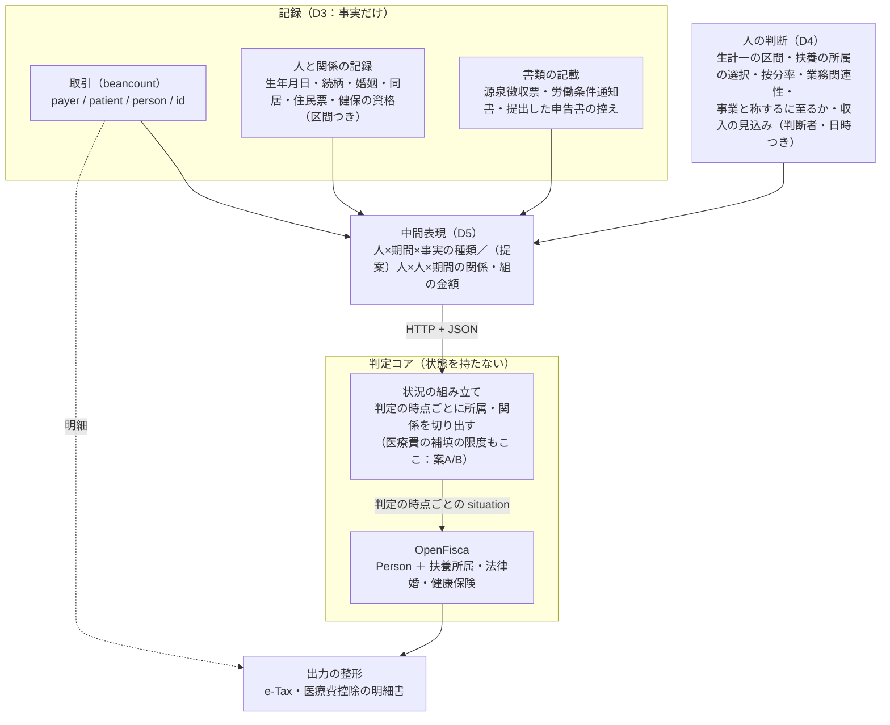
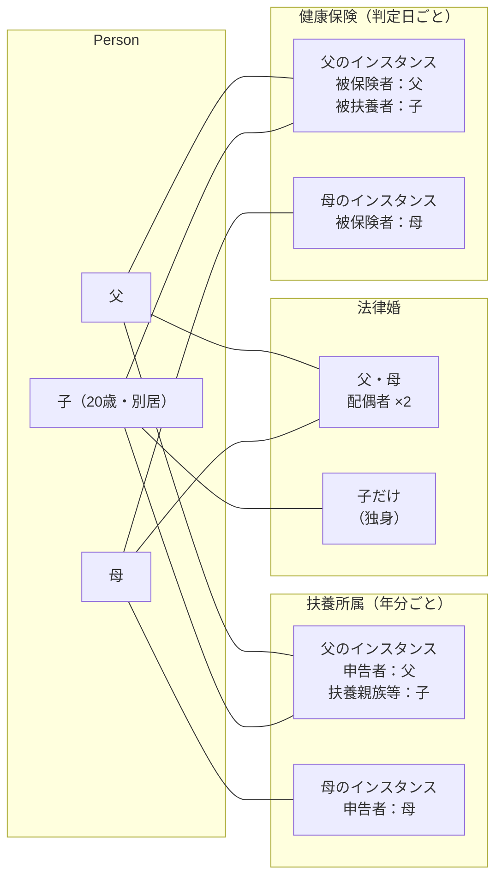
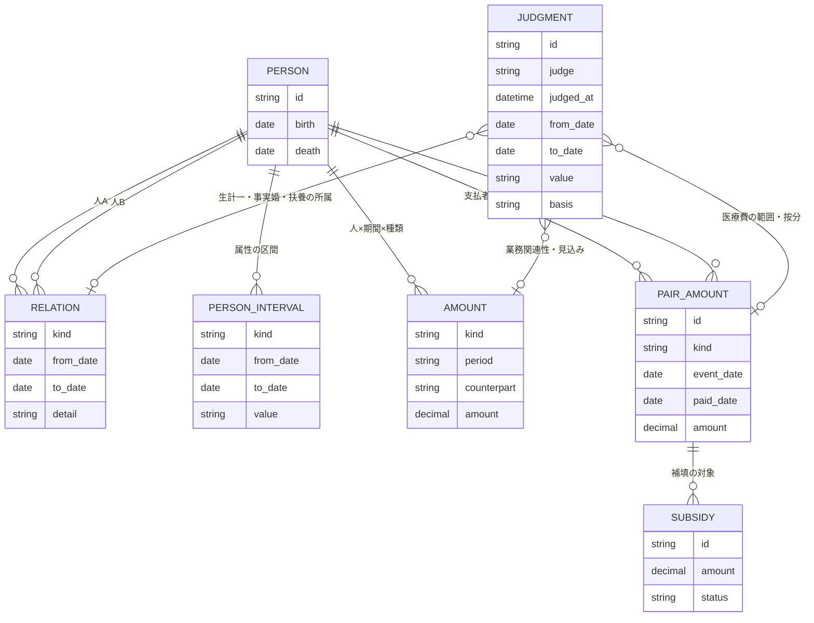
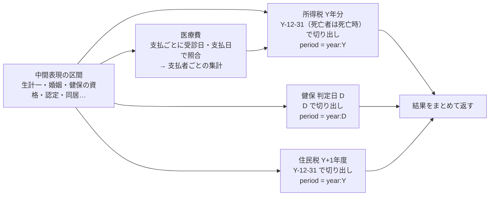

# R4 エンティティと関係のモデル案（仮説）

- 作成日：2026-11-09（R4 担当・後半）
- 種別：仮説（hypotheses）。根拠として参照するのは下の実測・公開資料の情報の文書だけ（外部の URL は参照しない）。
- この仮説から導いた推測と検証方法：`docs/inferences/20261109_R4-modeling_scenarios.md`
- 根拠の文書（以下の略号で参照）：
  - [CON] `docs/public-sources/20261109_R4-modeling_concepts.md`（概念の定義の原文）
  - [FETCH] `docs/measurements/20261109_R4-modeling_law-text-fetch.md`
  - [OF-run] `docs/measurements/20261109_R2-tools_openfisca-core-runtime.md`
  - [OF-src] `docs/public-sources/20261109_R2-tools_openfisca-core-source.md`
  - [BC-run] `docs/measurements/20261109_R2-tools_beancount-runtime.md`
  - [IT] `docs/public-sources/20261109_R1-laws_income-tax.md`
  - [LT] `docs/public-sources/20261109_R1-laws_local-tax.md`
  - [SA] `docs/public-sources/20261109_R1-laws_social-insurance-age-records.md`
  - [ART] `docs/measurements/20261109_R1-laws_article-extraction.md`
  - [NTA] `docs/public-sources/20261109_R3-tsutatsu_nta.md`
  - [SH] `docs/public-sources/20261109_R3-tsutatsu_shakaihoken-juminzei.md`
  - [REQ] `docs/public-sources/20261109_R3-tsutatsu_requirement-sources.md`
- 関連（根拠ではない）：R2 の仮説 H3 と推測 I3 が同じ OpenFisca の制約を扱っている。本書はそれらに依らず、上の実測・公開資料に直接よって組み立てた。
- 書き方：各判断の末尾の［ ］が根拠（文書と節）。「(I)」は根拠の文書から直接は言えず、この仮説で補った推論。
- 決定事項との関係：D2〜D5・D8 と HANDOFF §3 の境界（所得区分は判定コア、中間表現は事実まで）の中で組んだ。
  **D5 と D7 の細部に関わる提案が2つある（H6）**。ユーザーの確認が要る。
- 金額・条番号は根拠の文書に書かれたものだけを使う。施行日・適用年分は [IT] §1、[LT] §2、[SH] §1.2・§1.3 による。

---

## H0 層と用語

| 層 | 中身 | この案での役割 |
|---|---|---|
| 記録（D3） | 取引（plain text accounting）と、人と関係の記録（生年月日、続柄、婚姻、住民票、健保の資格など。取引ではないので台帳とは別のファイル。形式は未決 U11） | 事実だけ。所得区分などの法的な判断を含めない |
| 人の判断（D4） | 判断者・日時・対象（人、人の組、取引ID）・対象期間・値・根拠の参照 | 生計を一にするか、扶養の所属の選択、按分率など（H4） |
| 中間表現（D5） | 人 × 期間 × 事実の種類の集計値。**提案：人 × 人 × 期間の関係と、組の金額を加える（H6 提案1）** | 機械的な集計だけ。判定の時点を選ばない |
| 判定コア：状況の組み立て | 中間表現から、判定の時点ごとに OpenFisca の入力（situation）を作る Python の処理（**提案：コアの中に置く。H6 提案2**） | 法令上の判定の時点（12月31日、死亡時、認定日など）を知っているのはここだけ |
| 判定コア：OpenFisca | Person と3種類のグループ（H1） | 所得区分 → 所得 → 扶養判定・控除額 |
| 出力の整形 | e-Tax の XML、医療費控除の明細書 | 明細書は記録の明細から作る（H3.3） |

用語：

- **アンカー**：グループの中で `max: 1` の中心になる役割（扶養所属の「申告者」、健康保険の「被保険者」）。
- **アンカーとの関係**：グループの各構成員とアンカーとの2人の間の関係（続柄、生計を一にするか、送金額など）。

---

## H1 Person とグループの対応づけ

### H1.0 結論の表

| 候補 | 扱い | 主な理由 | 根拠 |
|---|---|---|---|
| 所得税の「扶養の所属」（控除を受ける居住者と、その人の扶養親族等として申告書に記載される人） | **グループ「扶養所属」** | 1人は1人の居住者の扶養親族・特定親族にしかなれず、どちらに属するかは申告書等の記載で決まる。OpenFisca の「同じ種類のグループでは1人1インスタンス」とそのまま一致する | [CON] §4.7（所法85⑥、所令219）、[OF-run] T02、[OF-src] §3.1 |
| 法律上の配偶者 | **グループ「法律婚」** | 配偶者控除・配偶者特別控除は、本人と配偶者の両方の合計所得金額を見る。配偶者を扶養所属に入れると、配偶者が同時に子の扶養の申告者になる場合に役割が重なる（1グループ1役割） | [CON] §3.2、[OF-run] T03 |
| 健康保険（被保険者と被扶養者） | **グループ「健康保険」** | 被扶養者の要件は「その被保険者」との続柄・同一世帯・生計維持で書かれ、被保険者の年間収入と比べる。アンカー（被保険者）を持つ単位になる | [CON] §4.3（健保法3⑦）、[SH] §1.1 |
| 住民票上の世帯 | **当面グループにしない**（人の事実として記録） | 扶養されている子供の所得税・健保の判定に住民票の世帯を使う原文がない。所得税では寡婦・ひとり親の判定（所規1の3・1の4）だけ、住民税は住所の判定（地法294②）に住民基本台帳を使う | [CON] §4.2、§5.2、§7 |
| 生計（生計を一にする） | **グループにしない**。2人の間の関係（区間つきの D4 判断）として持ち、必要な判定ではアンカーとの関係を人の変数にする | 「生計を一にする」は2人の関係として書かれ、定義規定がなく、推移的であることを言う原文もない。OpenFisca のグループは人の分割（種類ごとに1人1インスタンス）なので、関係の網を表せない | [CON] §4.1、§7、[OF-src] §3.1 |
| 家計 | **判定コアに渡さない**。記録層の独自の概念（どの人の取引を1つの台帳群にまとめて記録するか） | 法令の本文に出てくるが定義規定がなく、税・社会保険の扶養の要件に使われていない | [CON] §4.6 |
| 納税者本人の所得税 | **Person の変数で計算**（グループにしない） | 所得税は居住者ごとに計算する（所法73①「その居住者のその年分の総所得金額…から控除」など） | [CON] §5.3 |
| 国民健康保険、第3号被保険者、児童手当 | 当面は対象外 | 対象範囲は未決（HANDOFF §7 の3）。国保は一人ひとりが被保険者で被扶養者の区分がない、第3号は配偶者だけで子供に関係しない | [SH] §2・§3、[SA] §2 |

### H1.1 グループ「扶養所属」（所得税、年分ごと）

- **インスタンス**：扶養控除・特定親族特別控除などを受ける（受けうる）居住者1人ごと。
- **役割**：
  1. 申告者（`max: 1`、**最初の役割**）
  2. 扶養親族等（申告書に、扶養親族・特定親族などとして記載する人。配偶者は入れない → H1.2）
- 扶養親族か特定親族か、控除対象扶養親族・特定扶養親族かは、**判定コアが年齢と合計所得金額から決める**。19歳以上23歳未満の生計を一にする親族は、所得によって特定扶養親族か特定親族のどちらか一方になる［CON］§3.3（所法84の2①「控除対象扶養親族に該当しないもの」）。したがって所属のグループは「扶養親族用」「特定親族用」に分けず、1つにする。所法85⑥ も扶養親族と特定親族をまとめて「いずれか一」としている［CON］§4.7。
- 中間表現が持つのは「この人を、この年分に、この申告者の扶養親族等として記載する（した）」までで、該当するかどうかは持たない（HANDOFF §3 の境界）。
- **所属は年分ごとに1つで、年分のシミュレーションの中では変わらない**とみなしてよい。所属は申告書等の記載で決まり、記載で変えられる（所令219①ただし書）。変えるときは関係者全員が申告書等を出す（所基通85-2）［CON］§4.7。申告書等の種類（扶養控除等申告書、確定申告書など）ごとに記載が違いうるので、所属の記録には申告書等の種類を付ける (I)。
- 誰も扶養しない人・誰にも扶養されない人：自分だけのインスタンスの「申告者」。書き忘れても、OpenFisca は自分だけのインスタンスの最初の役割＝申告者にする［OF-run］T04、［OF-src］§3.1。誤って誰かの扶養が付くことはないが、**扶養の付け忘れは黙って起きる**。中間表現のスキーマで全員の所属を必須にする (I)。
- **アンカーとの関係を人の変数にする**：人は扶養所属に1つしか属さないので、「自分のインスタンスの申告者との関係」は人ごとに1つに決まる［OF-src］§3.1（`memberships` は人ごとに1つ）。次を人の変数として入れる（扶養親族等の役割の人だけ意味を持つ）：
  - 申告者との続柄（親族か、里子か、養護受託老人か。親等）［CON］§3.1、§3.3
  - 申告者と生計を一にするか（判定の時点の値。D4 の判断を状況の組み立てが切り出す → H2）［CON］§4.1
  - 申告者または申告者と生計を一にする居住者の青色事業専従者等か［CON］§3.4（所基通2-48・2-48の2）
  - 申告者からその年に受けた生活費・教育費の送金額（扶養親族が非居住者のときの要件。送金日で年に割り当てる）［CON］§3.3（所法2①三十四の二ロ（３）、所基通2-50）
- 扶養所属のグループの値（扶養控除の合計など）は、申告者の役割の人へ戻して申告者の税額計算に使う［OF-src］§3.1（グループから人の値を集める・人からグループの値を引く）。
- **重複の禁止**：同じ人を2人の申告者のインスタンスに書くと、OpenFisca はエラーにする（`declared more than once`）［OF-run］T02・T12n。所法85⑥ の「いずれか一」は入力の形で守られる。ただし OpenFisca のエラーは法令の言葉ではないので、状況の組み立ての前に中間表現の検査で止め、どの人が重複しているかを返す (I)。
- **所令219②（双方が記載した場合、既に扶養としている人、次に所得の合計額が最も大きい人の扶養親族とする）**は、重複した所属を入力に書けないので、OpenFisca の中では表せない［OF-run］T02。当面は扱わず、検査で止めて人の選択（D4）に戻す（未決 U2）。
- **限界**：扶養親族等として記載された人が、同時に別の人を自分の扶養親族等として記載する申告者になる場合は、1グループ1役割の制約で表せない［OF-run］T03（未決 U1）。配偶者の分は H1.2 で別のグループに分けたので、この限界には当たらない。

### H1.2 グループ「法律婚」

- **インスタンス**：婚姻している2人（民法739①：届出で効力）。独身者は自分だけのインスタンス。
- **役割**：配偶者（`max: 2`）。書き忘れた人は自分だけのインスタンスの配偶者＝独身と同じ扱いになり、害は小さい (I)［OF-run］T04。
- 所得税の「配偶者」は民法の配偶者だけで、事実婚を含まない（所基通2-46）。健保・国年は事実婚を含む（健保法3⑦一、国年法5⑦）［CON］§3.1 の表。したがって**法律婚のグループは所得税だけに使い、健保の判定には使わない**。健保は健康保険グループのアンカーとの続柄（「配偶者（事実婚を含む）」）で扱う (I)。
- 配偶者控除・配偶者特別控除は、本人の合計所得金額（1,000万円以下）と配偶者の合計所得金額の両方で決まる［CON］§3.2。法律婚のグループの中で「自分以外の配偶者」の値を引く。
- 配偶者が同一生計配偶者か他の居住者の扶養親族かは申告書等の記載で決まり、双方が記載したときは夫又は妻の同一生計配偶者とする（所令218。特別控除対象配偶者と特定親族の間も同じ構造：所令218の2）［CON］§4.7。これを次のように表す：
  - 他の居住者の扶養親族等としての記載 → 扶養所属（H1.1）
  - 配偶者の申告書への記載 → 人の変数「配偶者の申告書に配偶者として記載する（した）か」（D4 の選択、提出後は事実）
  - どちらが優先するか（所令218②） → 判定コアの式
- 配偶者特別控除の相互適用の禁止（所法83の2②一）も法律婚の中で表せる［CON］§3.2。
- **限界**：年の途中で配偶者が死亡し、その年中に再婚した場合（所法85⑦、所令220）は、同じ人が2つの婚姻に属するので表せない［CON］§5.4、［OF-run］T02。役割「年の中途で死亡した配偶者」（`max: 1`）を足す案があるが、未検証（未決 U7）。

### H1.3 グループ「健康保険」（被扶養者の判定日ごと）

- **インスタンス**：健康保険の被保険者1人ごと。
- **役割**（この順で定義する）：
  1. 対象外（**最初の役割**。健保の被保険者でも被扶養者でもない人、たとえば国保の加入者）
  2. 被保険者（`max: 1`）
  3. 被扶養者
- 最初の役割を「対象外」にする理由：書き忘れた人は、自分だけのインスタンスの最初の役割になる［OF-run］T04。最初の役割が「被保険者」だと、国保の加入者を書き忘れただけで健保の被保険者として扱われる。
- 被扶養者の役割の意味は「その被保険者の被扶養者として届け出ている（届け出る予定の）人」。**要件を満たすかどうかは判定コアが計算する目安**で、認定するのは保険者（昭和52年通知「保険者が行う取扱い」）［SH］§1.1。認定されたかどうかは記録の事実として別に持つ（H5.2）。
- アンカー（被保険者）との関係を人の変数として入れる：被保険者との続柄（健保法3⑦一〜四の区分。配偶者は事実婚を含む）、被保険者と同一の世帯に属するか（未決 U3）、被保険者からの援助額（仕送り）［CON］§4.3、［SH］§1.1。
- 被保険者の年間収入は、グループの中で被保険者の役割の人から引く（`value_from_person` は `max: 1` の役割だけ）［OF-src］§3.1。昭和52年通知の「被保険者の年間収入の2分の1未満」に使う［SH］§1.1。
- 収入の基準（130万円・180万円・150万円・2分の1・援助額）は**通知**で決まっているので、法令由来の枠組み（続柄・同一世帯・国内居住）とは別のパラメータ群にする［REQ］§1 の #12〜#16、［SA］§1。
- 1人の被扶養者を2人の被保険者の被扶養者として書くと、OpenFisca はエラーにする［OF-run］T02。また被保険者は同じ種類のグループで被扶養者の役割を持てない［OF-run］T03。**どちらも法令上そうであることは docs では確認していない**（I。未決 U9）。
- 健康保険のグループは、所属が日付で変わる（被扶養者の認定・削除、就職による資格取得）。判定日ごとに別のシミュレーションを作る（H2）。

### H1.4 住民票上の世帯（グループにしない）

- 住民票の世帯ID・世帯主か・世帯主との続柄は、区間つきの事実として記録し、中間表現にも入れる（H5.2）。判定コアのグループにはしない。
- 理由：扶養されている子供の扶養（所得税）・被扶養者（健保）の要件に、住民票の世帯を直接使う原文がない［CON］§5.2、§7。健保法3⑦二〜四の「同一の世帯」も定義規定がなく、住民票の世帯と同じかは分からない［CON］§4.2・§8（未決 U3）。
- 国保の保険料（世帯主が納付義務者）、寡婦・ひとり親（住民票の続柄を使う）を扱うときに、グループ「住民票世帯」（役割：世帯員を最初、世帯主 `max: 1`）を足す［CON］§4.2 の表。R2 の実測で、生計と住民票世帯が食い違う家族を同時に表せることは確かめてある［OF-run］T01。

### H1.5 生計を一にする（グループにしない）

- 原文は「居住者と生計を一にする」「自己と生計を一にする」のように**2人の関係**として書いている［CON］§4.1、§7。
- 判定に使うのは、いつも「ある人（申告者、医療費の支払者、社会保険料の支払者、事業主）」から見た相手との関係である［CON］§3.3、§3.4、§5.3。したがって、
  - 扶養所属では「申告者との生計一」を人の変数にする（H1.1）。
  - 医療費控除・社会保険料控除では、支払ごとに「支払者と受診者（負担すべき人）の生計一」を状況の組み立てが判定し、支払者の人の変数に集計する（H3.3）。
- 「生計」のグループを作ると、次のような関係を表せない (I)：父は別居の祖母（仕送り）とも別居の学生の子（仕送り）とも生計を一にするが、祖母と孫の間に直接の起居・送金はない。原文には、生計を一にする関係が推移的だとは書かれていない［CON］§4.1。
- 雑損控除の親族の所属（所令205②）は「生計を一にする居住者が二人以上ある場合」の規則を持つ［CON］§4.7。雑損控除を扱うときに、扶養所属と同じ形の別のグループが要るかを検討する（未決 U12）。

### H1.6 役割の順序と書き忘れのまとめ

| グループ | 最初の役割 | 書き忘れたときの結果 | 対策 |
|---|---|---|---|
| 扶養所属 | 申告者 | 自分だけの申告者（扶養なし）。扶養の付け忘れが黙って起きる | スキーマで全員の所属を必須にする |
| 法律婚 | 配偶者 | 独身と同じ。配偶者の付け忘れが黙って起きる | 同上 |
| 健康保険 | 対象外 | 健保に入っていない人と同じ。被扶養者の付け忘れが黙って起きる | 同上。記録の「健保の資格」の事実と照合する |

根拠：［OF-run］T04、［OF-src］§3.1（`flattened_roles[0]` が割り当てられる）。

---

## H2 時間の扱い

### H2.1 原則：所属・関係は区間で持ち、判定の時点ごとに切り出して別のシミュレーションにする

- OpenFisca の所属と役割には期間の次元がなく、1つのシミュレーションの中で変えられない［OF-run］T14・T14b、［OF-src］§3.1。
- 一方で、制度ごとに判定の時点が違い［CON］§5.1、年の途中で婚姻・死亡・出国・専従者の変更・居住者の区分が変わる［CON］§5.4。
- そこで：
  1. 中間表現では、所属・関係・D4 の判断を**区間（開始日・終了日）つき**で持つ。
  2. 判定コアの「状況の組み立て」が、判定ごとに決まった日付で区間を切り出し、その日付の所属でシミュレーションを1つ作る。
  3. 1回の判定要求（1家族・1年分など）から、複数のシミュレーションを作って結果をまとめて返す。コアは状態を持たないので（D8）、回数が増えるだけ (I)。
- 判定ごとの日付と期間：

| 判定 | 所属・関係を切り出す日 | OpenFisca の期間 | 根拠 |
|---|---|---|---|
| 所得税 Y年分の扶養親族・特定親族・同一生計配偶者など | Y年12月31日。判定される人がそれより前に死亡していれば死亡の時 | `year:Y` | ［CON］§5.1（所法85③） |
| 所得税：居住者本人が年の中途で死亡・出国 | 死亡・出国の時。合計所得金額はその時の現況で見積もった1月1日〜12月31日の額 | `year:Y` | ［CON］§5.1（所基通85-1） |
| 所得税：年末調整 | 年末調整を行う日の現況（年齢は12月31日の現況） | `year:Y` | ［NTA］§2.3 |
| 医療費控除の「生計を一にする親族」 | 支払ごとに、支出すべき事由が生じた時（受診日とみなす (I)）**又は**支払った時 | 支払日で年に割り当てる | ［CON］§5.1（所基通73-1・73-2）、［NTA］§1.2 |
| 住民税 Y+1年度 | Y年12月31日（前年12月31日） | `year:Y` | ［CON］§5.1（地法314の2⑧）、［LT］§1・§3 |
| 健保の被扶養者（収入の見込み） | 判定日（認定日） | `year:<判定日>`（判定日から1年。月の途中からの1年も表せる） | ［SH］§1.2 Q5・Q8、§1.3 Q9、［OF-run］T06、［OF-src］§3.2 |
| 健保の被扶養者（年齢の区分 150万円） | 判定日の属する年の12月31日の年齢 | — | ［SH］§1.2（Q4、日本年金機構の案内） |

- 所得（暦年の収入・経費）は所属と関係なく人の変数なので、切り出しの影響を受けない。月の変数を年で合計できる［OF-run］T06。
- パラメータは、年の変数では期間の始まりの日の値が使われる［OF-run］T07。所得税の基準額は年分の1月1日を始まりにすれば年分の全体に効く（施行は12月1日でも年分の全体に適用されるため）［IT］§1。健保の基準額は、期間を `year:<判定日>` にすれば判定日の値が引かれ、150万円が「令和7年10月1日以後の認定」から効くことと合う (I。月の途中から始まる期間でパラメータを引くことは未実測)［SH］§1.2。
- **入力の粒度は変数ごとに1つに決める**。同じ変数に、ある人は月ごと、別の人は年額で入れると失敗する［OF-run］T06x。給与の支払は全員「月」、業務の収入・経費は全員「年」のように、中間表現のスキーマで変数ごとに粒度を固定する (I)。
- 入力の欠けは既定値（0 など）として黙って計算される［OF-run］T06（入力の無い月は 0）、T12l（前の年を参照し続けると既定値で打ち切り）。事業所得か雑所得かの判断に使う「例年（概ね3年）の収入」［NTA］§1.4 のように**前年以前の値を使う判定では、前年以前の値を必ず入力し、欠けを検査で止める** (I)。

### H2.2 月ごとに所属が効く計算

- 扶養されている子供の所得税・被扶養者の判定には、月ごとに所属を変えて計算する必要のあるものは、docs の範囲では見当たらない (I)。
- 必要になったら（国保の月割りなど）、所属の代わりに「その月に被扶養者として認定されている」のような月の真偽値の変数（記録の事実）で入れる。所属と違って変数は期間を持てる［OF-src］§3.2。

### H2.3 年の途中の変化の扱い

| 変化 | 扱い | 根拠 |
|---|---|---|
| 就職して自分の健保の被保険者になる | 健康保険の所属が判定日によって変わる → 判定日ごとのシミュレーション。所得税の年分のシミュレーションには影響しない | ［CON］§4.3、［OF-run］T14 |
| 独立して別居し、生計を一にしなくなる | D4 の生計一の区間が終わる。所得税は12月31日の値だけを見る | ［CON］§5.1（所法85③） |
| 年の中途で結婚 | 法律婚の区間の始まり。所得税は12月31日の値 | ［CON］§5.1 |
| 扶養親族の死亡 | 判定される人の死亡時の現況で切り出す | ［CON］§5.1（所法85③ただし書） |
| 申告者（居住者本人）の死亡・出国 | その時の現況で切り出し、相続人など他の居住者が同じ人を控除してよい例外がある | ［CON］§4.7（所基通83〜84の2-1）、§5.1（所基通85-1） |
| 年の中途まで他の人の青色事業専従者 | その人の専従者に当たらなければ扶養親族から除かれない | ［CON］§3.4（所基通2-48） |
| 居住者・非居住者の区分の変化 | 人の区間つきの事実（国内の住所・居所）と判断（居住者か）として持つ | ［CON］§2.1（所基通2-3） |

---

## H3 重複控除の禁止・扶養の選択・医療費：どの層で表すか

### H3.1 層ごとの分担

| 事柄 | 記録（事実） | 人の判断（D4） | 中間表現 | 判定コア |
|---|---|---|---|---|
| 扶養親族等を誰の申告書に記載するか | 提出した申告書等の控え（記載の事実、年分、申告書等の種類） | 提出前の選択（判断者・日時・年分・申告書等の種類） | 年分ごとの扶養所属（人 → 申告者） | 扶養所属のグループ |
| 1人を2人が重ねて扶養しない（所法85⑥） | — | — | 1人に1つの所属しか書けない形（スキーマ） | 検査で止める。OpenFisca でも T02 でエラー |
| 双方が記載したときの規則（所令219②） | — | — | — | **当面扱わない**（未決 U2） |
| 配偶者と他の居住者の扶養親族の重複（所法85④⑤、所令218・218の2） | 申告書等の記載 | 記載の選択 | 法律婚、扶養所属、「配偶者の申告書に記載するか」 | 所令218②の優先を式で書く |
| 同じ人について扶養控除と障害者控除を別の居住者が受けない（所基通79-1） | — | — | — | 扶養所属の同じ申告者で障害者控除も計算すれば、自然に守られる (I) |
| 年の中途で死亡・出国した居住者の分の例外（所基通83〜84の2-1） | 死亡・出国の日 | — | 死亡・出国した居住者の扶養所属を、その年分の別の要求として持つ | 別のシミュレーション（H2.1） |
| 医療費控除 | 支払1件ごとの支払者・受診者・受診日・支払日・医療機関・金額・証憑、補填の給付 | 医療費の範囲に入るか、支払者と受診者が生計を一にするか（区間） | H3.3 の案A／案B | 支払者の Person の変数。扶養所属を使わない |
| 社会保険料控除（所法74） | 支払1件ごとの支払者・負担すべき人・種類・金額 | 生計を一にするか（区間） | 医療費と同じ形 | 支払者の Person の変数 |

根拠：［CON］§4.7、§5.3、［OF-run］T02、［NTA］§1.2、§3、［BC-run］§3。

### H3.2 「誰の扶養にするか」は人の選択（D4）で、提出後は事実

- 所令219①は「申告書等に記載されたところによる」とし、ただし書で記載を変えて他の居住者の扶養親族とすることを妨げないとする［CON］§4.7。法令は、所属を**家族が選ぶもの**として扱っている。
- したがって、申告書を出す前は D4 の判断（「この年分は子を父の扶養親族等として記載する」、判断者・日時つき）、出した後は記録の事実（申告書等の控えの記載）として持つ (I)。
- 「どの所属が有利か」を比べたいときは、候補の所属ごとに別のシミュレーションを作って結果を並べ、選ぶのは人にする。判定コアは選ばない（D8、所属の選択は法令の規則ではなく家族の選択のため）(I)。

### H3.3 医療費控除：扶養と関係なく、支払った人が控除する

- 控除を受けるのは**支払った居住者**で、対象は「自己又は自己と生計を一にする配偶者その他の親族に係る医療費」。扶養親族であることも、所得・年齢の要件も問わない［CON］§5.3、§7（所法73①）。扶養所属（所法85⑥）の規定も参照していない［CON］§4.7。
- したがって**医療費控除は扶養所属のグループを使わず、支払者の Person の変数で計算する**。
- 支払者を役割とする「医療費の負担」グループは作らない。1人の受診者の医療費を2人（父と母）が別々に払うと、受診者を同じ種類の2つのインスタンスに書くことになり、エラーになる［OF-run］T02 (I)。
- 同じ支払を2人が重ねて控除できないことを直接定めた原文は見つかっていない［CON］§8。この案では1件の支払に支払者が1人なので、記録の形で二重計上が起きない (I)。
- 記録層：beancount のメタデータで支払者（`payer:`）と受診者（`patient:`）を別々に持ち、人 × 期間で集計できることは実測済み［BC-run］§3。取引ID（`id:`）で D4 の判断や補填の給付から支払を参照できる［BC-run］§3（重複は自分で検査する）。メタデータのキーは ASCII だけ［BC-run］§2。
- **粒度の問題**：
  - 生計を一にするかの判定の時点が支払ごとに違う（支出すべき事由が生じた時又は支払った時）［NTA］§1.2（73-1）。
  - 補填する保険金等は「給付の目的となった医療費の金額を限度として差し引き、引ききれない金額を他の医療費から差し引かない」［NTA］§3（TA1120）、§1.2（73-8〜73-10）。
  - どちらも支払・補填の単位の計算で、人 × 年の合計だけからは出せない。OpenFisca の変数は人またはグループごとの配列で、1人の中に長さの決まらない明細を持てない［OF-src］§3.1 (I)。
  - **案A（推す）**：中間表現に医療費の明細（支払ID、支払者、受診者、受診日、支払日、金額、補填の単位ID）と補填の単位ごとの補填額（確定か見込みか）を入れる。判定コアの状況の組み立てが、D4 の生計一の区間と照らして支払ごとに対象かを決め、補填の単位ごとに限度を当てはめ、支払者ごとに「控除の対象となる医療費（補填後）」を集計して Person の変数に入れる。法令の規則はすべてコアにある。ただし D5 の「集計値」から外れる（H6 提案1、未決 U4）。
  - **案B**：D5 を守る。人が D4 で支払ごとに「73-1 に照らして、受診者は支払者と生計を一にする親族か」を付け、中間表現は（支払者 × 判断の値 × 補填の単位）ごとの合計にする。73-1 の当てはめを人に任せることになる。補填の単位ごとの限度は、単位ごとの合計からコアの状況の組み立てで計算できる。
  - いずれの案でも、**補填の限度の計算は OpenFisca の変数ではなく、コアの状況の組み立て（Python）に置くことになる**。その部分は OpenFisca のパラメータの施行日や `/trace` の外にあるので、別にテストと監視の対象（D9 の「影響する層」）にする (I。未決 U4)。
- 医療費控除の明細書（出力）は受診者・医療機関ごとの明細が要るので、出力の整形は記録の明細から作る［NTA］§3（TA1120）。判定コアの結果（控除額）と明細書の合計が一致することを検査する (I)。

---

## H4 事実か、人の判断（D4）か

| 項目 | 区分 | 理由 | 根拠 |
|---|---|---|---|
| 生計を一にするか | **人の判断（D4）**。材料は事実（日常の起居、余暇の起居、送金の日・額・名目） | 定義規定がなく、通達は「常例としている」「常に…送金」「明らかに互いに独立した生活」のように事実の評価を含む書き方をしている | ［CON］§4.1、§7、［NTA］§1.1 |
| 誰の扶養（所得税）に入れるか | **人の選択（D4）**。申告書等を出した後は**事実**（記載） | 所令219①が記載によるとし、変更もできる | ［CON］§4.7 |
| 誰の健保の被扶養者として届け出るか | 届出前は人の選択（D4）、届出・認定は**事実** | 認定は保険者が行う | ［SH］§1.1、［CON］§4.3（健保則38） |
| 被扶養者の要件（主として生計を維持）を満たすか | **判定コアの計算（目安）**。最終的には保険者の認定（事実） | 基準は通知にあり、通知は「実態と著しくかけ離れ…最も妥当と認められる認定」も許す | ［SH］§1.1 |
| 健保の今後1年間の年間収入の見込み | **人の判断（D4）**。令和8年4月1日以後の認定は、労働契約の内容（事実）からコアが計算する道もある | 見込みは「過去・現在の収入、将来の見込みから」人が見積もる。労働契約による判定は通知の規則 | ［SH］§1.2（Q5）、§1.3 |
| 家事関連費の按分率、明らかに区分できるか | **人の判断（D4）**（根拠：面積・時間などの記録の参照） | 通達は「総合勘案」「明らかに区分できる場合」とする | ［NTA］§1.3（45-1・45-2、TA2210） |
| 支出が業務に関連するか | **人の判断（D4）** | HANDOFF D4 の例そのもの | （HANDOFF D4） |
| 社会通念上事業と称するに至る程度か | **人の判断（D4）**。所得区分そのものは**判定コア**が、帳簿書類の保存（事実）・収入金額（事実）・D4 の判断から決める | 通達の注の前段は社会通念、後段は帳簿書類の保存と300万円で書かれている | ［NTA］§1.4（35-2）、HANDOFF §3 |
| 雇用か請負か（区分が明らかでないとき） | **人の判断（D4）**。契約書の種類・源泉徴収票の有無は**事実** | 通達は代替性・時間的拘束・指揮監督などの総合勘案（業種を限った通達・消費税の通達） | ［NTA］§1.5 |
| 医療費の範囲に入るか（予防・美容・通院費など） | **人の判断（D4）** | 通達が「直接必要な費用」「予防・健康増進のためのもの」など評価を含む書き方をしている | ［NTA］§1.2（73-3〜73-5） |
| 補填の給付がどの医療費に対するものか | **事実**（給付の通知書） | 限度の計算に要る | ［NTA］§1.2（73-8）、§3 |
| 親族か、続柄・親等 | **事実**（戸籍） | 民法725〜729。ただし所得税法の「親族」が民法と同じ意味だと明記した原文は未確認 | ［CON］§3.1、§8 |
| 法律上の配偶者 | **事実**（婚姻の届出） | 民法739①、所基通2-46 | ［CON］§3.1 |
| 事実婚（事実上婚姻関係と同様の事情） | **人の判断（D4）** | 健保・国年で要件。住民票の続柄「未届の夫・妻」は事実として別に記録する | ［CON］§3.1 の表 |
| 同居（日常の起居を共にする） | 区間つきの**事実**。「同居を常況としている」かは D4 | 所法79③・地法314の2④ | ［CON］§4.1 の表 |
| 住民票の世帯・世帯主との続柄 | 区間つきの**事実** | 住基法7四 | ［CON］§4.2 |
| 健保の「同一の世帯に属する」か | **未決**（住民票の世帯から機械的に決めてよいか分からない） | 定義規定がない | ［CON］§4.2、§8（未決 U3） |
| 居住者か | 材料は**事実**（国内の住所・居所の区間）、判定は**人の判断（D4）** | 住所は生活の本拠で、客観的事実で判定する | ［CON］§2.1（所基通2-1・2-2） |
| 年齢 | **事実**（生年月日）から判定コアが計算 | 年齢の判定の時点は制度ごとに違う | ［CON］§2.2、§5.1、［SH］§1.2（Q4） |
| 専ら事業に従事するか（専従者） | 材料は**事実**（従事した期間、学生か、他の職業）、6か月を超えるかの判定は**判定コア** | 所令165 | ［CON］§3.4 |

---

## H5 記録層・中間表現に必要な事実の一覧

法的な判断（所得区分、所得の金額、扶養親族などに当たるか）は含めない。金額は記録の取引から機械的に集計する。

### H5.1 人の属性

| 事実 | 粒度 | 出所 | 使う判定 | 根拠 |
|---|---|---|---|---|
| 人ID、生年月日 | 人 | 人と関係の記録 | すべての年齢区分 | ［CON］§2.2 |
| 死亡日 | 人 | 同上 | 判定の時点（所法85③ただし書） | ［CON］§5.1 |
| 国内の住所・居所の有無、国外にいた期間とその目的（留学・赴任同行など） | 人 × 区間 | 同上 | 居住者か、健保の国内居住要件とその例外 | ［CON］§2.1、§4.3（健保則37の2） |
| 在学（学校の種類、昼間・夜間） | 人 × 区間 | 在学証明など | 勤労学生、専従者の期間の除外 | ［IT］§4、［CON］§3.4（所令165②） |
| 障害者手帳など | 人 × 区間 | 同上 | 障害者控除、健保の180万円 | ［SH］§1.1 |
| 健保の資格（保険者、被保険者か、資格の取得日・喪失日） | 人 × 区間 | 資格確認書・通知 | 健康保険の所属 | ［CON］§4.3 |
| 健保の被扶養者としての認定（どの被保険者の、認定日・削除日） | 人 × 区間 | 保険者の通知 | 健康保険の所属、認定の事実 | ［SH］§1.2（Q8）、§1.3（Q9） |
| 事業主の証明による認定継続を使った年 | 人 × 年 | 事業主証明 | 連続2回までの制限 | ［SH］§1.5 |
| 住民票の世帯ID、世帯主か、世帯主との続柄 | 人 × 区間 | 住民票 | （当面）ひとり親・国保を扱うとき。健保の同一世帯（未決 U3） | ［CON］§4.2 |
| 勤務先ごとの扶養控除等申告書の提出（甲・乙・丙欄） | 人 × 勤務先 × 年 | 源泉徴収票・給与明細 | 源泉徴収・年末調整 | ［NTA］§2.3 |

### H5.2 人と人の関係（区間つき）

| 関係 | 出所 | 使う判定 | 根拠 |
|---|---|---|---|
| 親子・婚姻（届出）・養子縁組・離縁・離婚・姻族関係の終了 → 続柄と親等 | 人と関係の記録（戸籍） | 親族か、健保の続柄の区分 | ［CON］§3.1、§4.3 |
| 里親委託・養護受託 | 同上（委託の書類） | 扶養親族・特定親族に親族でない人を含める | ［CON］§3.1、§3.3 |
| 日常の起居を共にする（同居） | 同上 | 生計一の判断の材料、同居老親・同居特別障害者 | ［CON］§4.1 |
| 青色事業専従者給与・事業専従者としての従事（事業主、従事した期間） | 取引と人の記録 | 扶養親族からの除外 | ［CON］§3.4 |
| 生計を一にする（D4） | 人の判断 | 扶養、配偶者、医療費、社会保険料、専従者 | ［CON］§4.1 |
| 事実婚（D4） | 人の判断 | 健保の配偶者 | ［CON］§3.1 |
| 扶養の所属（D4 の選択／申告書等の記載の事実。年分・申告書等の種類つき） | 人の判断・記録 | 扶養所属のグループ | ［CON］§4.7 |
| 配偶者の申告書に配偶者として記載するか（同上） | 同上 | 所令218 | ［CON］§4.7 |

### H5.3 金額の種類（人 × 期間）

| 金額の種類（事実の段階） | 粒度 | 出所 | 判定コアでの使い道（区分はコアが決める） | 根拠 |
|---|---|---|---|---|
| 雇用契約に基づく給与の支払額（支払者別。支給項目の種類別：基本給、時間外、通勤手当など） | 人 × 支払者 × 月（支払日） | 給与明細の取引 | 給与所得、健保の年間収入 | ［IT］§4（所法28）、［SH］§1.4 |
| 源泉徴収票の支払金額・源泉徴収税額（支払者別） | 人 × 支払者 × 年 | 源泉徴収票 | 給与収入の確定値、還付 | ［NTA］§2.3 |
| 業務委託・請負の報酬（支払者別、支払調書・源泉徴収の有無） | 人 × 業務 × 年 | 取引 | 事業所得か雑所得か給与所得か（コア） | ［NTA］§1.4、§1.5 |
| 業務の売上（業務別） | 人 × 業務 × 年 | 取引 | 同上 | ［NTA］§1.4 |
| 業務の支出（業務別・費目別。業務関連性は D4） | 人 × 業務 × 費目 × 年 | 取引＋D4 | 必要経費（コア） | ［IT］§4（所法27・35） |
| 家事関連費の支出額（費目別）と、D4 の按分率・区分できるか | 人 × 費目 × 年 | 取引＋D4 | 必要経費に入る部分（コアが 45-2 を当てはめる） | ［NTA］§1.3 |
| 帳簿書類を保存しているか（業務別） | 人 × 業務 × 年 | 記録そのものの有無 | 35-2（注）後段 | ［NTA］§1.4 |
| 業務の前年・前々年の収入金額 | 人 × 業務 × 年（過去3年程度） | 取引 | 書類保存義務、例年の判断の材料 | ［NTA］§1.4（TA1500） |
| 非課税の給付（失業給付、傷病手当金、出産手当金、遺族・障害年金など） | 人 × 種類 × 月 | 給付の通知 | 健保の年間収入（所得税の合計所得金額には含めない） | ［SH］§1.4 |
| 労働契約の内容（時給、所定の労働時間・日数、手当の額、契約期間） | 人 × 契約 × 区間 | 労働条件通知書 | 令和8年4月1日以後の認定の年間収入（コア） | ［SH］§1.3 |
| 健保の今後1年間の収入の見込み（D4） | 人 × 判定日 | 人の判断 | 被扶養者の目安 | ［SH］§1.2（Q5） |

### H5.4 組の金額（人 × 人 × 日付）

| 組の事実 | 出所 | 使う判定 | 根拠 |
|---|---|---|---|
| 送金（送金者、受取人、送金日・カード利用日・電子決済手段の移転日、金額、名目：生活費・学資金・療養費など） | 取引 | 生計一の判断の材料、非居住者の扶養親族の38万円、健保の別世帯の援助額 | ［CON］§3.3（所基通2-50）、［NTA］§1.1、［SH］§1.1 |
| 医療費の支払（支払ID、支払者、受診者、受診日、支払日、医療機関・薬局、金額、証憑の種類：領収書・医療費通知） | 取引（`payer:`・`patient:`・`id:`） | 医療費控除（H3.3） | ［BC-run］§3、［NTA］§1.2、§3 |
| 補填の給付（受取人、金額、受取日、対象の医療費の支払ID、確定か見込みか、種類） | 取引・通知 | 医療費控除の補填の限度 | ［NTA］§1.2（73-8〜73-10）、§3 |
| 社会保険料の支払（支払者、負担すべき人、種類、金額、支払日） | 取引 | 社会保険料控除（所法74） | ［CON］§5.3 |
| 生計を一にする親族への対価の支払（事業主、受取人、種類） | 取引 | 所法56（必要経費に入れない） | ［CON］§3.4、［NTA］§1.3（TA2210） |

### H5.5 中間表現に入れないもの（判定コアで決める）

- 所得区分（給与・事業・雑・一時など）と各所得の金額、合計所得金額、総所得金額等（HANDOFF §3）。
- 扶養親族・控除対象扶養親族・特定扶養親族・特定親族・同一生計配偶者・控除対象配偶者などに当たるか。
- 被扶養者の要件を満たすか（目安）。
- 必要経費の額（按分の当てはめ後）、医療費控除の対象額（補填の限度の当てはめ後）。
- 年齢、年齢の区分、判定の時点の選択（H2.1）。

---

## H6 中間表現から OpenFisca への変換の置き場所（D5・D7 の細部への提案）

### 提案1：中間表現に「人 × 人 × 期間の関係」と「組の金額」を加える（D5 の拡張）

- 理由：生計一・続柄・送金・医療費・社会保険料は**2人の間の事実**で、人 × 期間の集計だけでは表せない［CON］§7、§5.3。扶養の判定で使うのは「申告者との」関係で、誰が申告者かは扶養所属（D4 の選択）で決まる。所属を決める前に人 × 期間へ集計すると、どの相手との関係かが失われる (I)。
- D5 の「機械的な集計で、法令の解釈を含まない」は変えない。拡張は集計のキーに「相手の人」を加えるだけ。
- 医療費の明細を入れる案A（H3.3）は、さらに「集計値」から明細に踏み込む。D5 を守るなら案B。どちらにするかはユーザーの確認が要る（未決 U4）。

### 提案2：状況の組み立てを判定コアの中に置き、クライアントは中間表現を送る（D7 の細部）

- 理由：判定の時点（12月31日、死亡時、年末調整の日、認定日、前年12月31日）は法令の規定である［CON］§5.1。所属の切り出しをクライアント（TS）側に書くと、法令の知識が判定コアの外に出て、D2（記録の定義と判定ロジックを分ける）が崩れる (I)。
- OpenFisca の Web API の前には、どのみち自作のラッパーが要る：既定で CORS が全オリジン許可、認証なし、本文の大きさ・`axes` の上限なし、数値の欄の文字列が式として評価される［OF-run］T11、T12f〜T12j、T12o、［OF-src］§2.3、§2.5。中間表現の JSON Schema による検査と状況の組み立てを、このラッパーに置く (I)。
- D7（OpenFisca を Web API として起動し、HTTP + JSON で呼ぶ）は変わらない。変わるのは、送る JSON が OpenFisca の situation ではなく中間表現になること、1回の要求から複数のシミュレーションを作ることである。
- 代わりの案：クライアントが判定の時点ごとの situation を作り、OpenFisca の `/calculate` を直接呼ぶ。法令の知識（判定の時点）がクライアントに漏れ、法令の変更で TS 側も直す必要が出る。

---

## 図

### 図1 層と、各事柄の置き場所

### 図2 OpenFisca のエンティティ（例：別居の大学生のいる家族、令和8年分・判定日 2026-04-01）

住民票の世帯（子は単独の世帯）と生計一（子と父・母：D4）は、グループではなく人と関係の事実・判断として中間表現に入る。

### 図3 記録層・中間表現の事実（ER 図）

### 図4 時間：区間から判定の時点ごとのシミュレーションへ

---

## 未決

| ID | 内容 | 決められない理由 | 次にすること |
|---|---|---|---|
| U1 | 扶養親族等として記載された人が、同時に別の人を扶養する申告者になる場合を表せない（1グループ1役割） | どれくらい起きるかの資料がない。法令上それが許されないことを示す原文も docs にない | 頻度の確認。必要なら「扶養所属」を2種類（2段）に分けるか、検査で止めて別要求にする案を比べる |
| U2 | 所令219②（双方が記載した場合の規則）を判定コアで扱うか | OpenFisca の入力で重複を表せない。扱うなら状況の組み立てで所属を決める必要があり、所得の合計額（コアの計算結果）を先に求める2段の計算になる | 当面は検査で止める。ユーザーに範囲を確認 |
| U3 | 健保の「同一の世帯に属する」を住民票の世帯で決めてよいか | 定義規定がなく、行政の文書を取得していない | public-sources に資料を追加（下） |
| U4 | 医療費の粒度：案A（明細を中間表現に入れる、D5 の拡張）か案B（D4 で支払ごとに判断を付ける）か。補填の限度の計算を OpenFisca の外（状況の組み立て）に置いてよいか | D5 の「集計値」と D6 の「判定ロジックは OpenFisca の上」に関わる | ユーザーの確認（H6） |
| U5 | 中間表現に人 × 人の関係を入れる拡張（H6 提案1）、状況の組み立てをコアに置くこと（H6 提案2） | D5・D7 の細部に関わる | ユーザーの確認 |
| U6 | 住民税で、1人が2人以上の納税義務者の扶養親族に当たる場合の所属の規則 | 地方税法施行令などを取得していない［CON］§8 | public-sources に追加 |
| U7 | 年の途中の配偶者の死亡と再婚（所令220）の表し方 | 同じ人が2つの婚姻に属する。役割を足す案は未検証 | 推測の検証のときに試す |
| U8 | 健保で夫婦の両方が被保険者のとき、子をどちらの被扶養者にするかの基準 | docs に通知がない | public-sources に追加 |
| U9 | 1人が2人の被保険者の被扶養者になれないこと、被保険者が同時に被扶養者になれないことの法令上の根拠 | docs で未確認（OpenFisca の制約とは一致する） | public-sources に追加 |
| U10 | 所法45（家事関連費）・所令96 が業務に係る雑所得の計算にも及ぶか | 通達 45-1・45-2 と TA2210 は読んだが、条文の原文が docs にない | public-sources に追加 |
| U11 | 人と関係の記録（取引でない事実）と D4 の判断の記録の形式 | beancount の台帳とは別のファイルが要るが、形式を比べていない | 中間表現のスキーマ案の段階で決める |
| U12 | 雑損控除の親族の所属（所令205②）に、扶養所属と同じ形の別のグループが要るか | 雑損控除を対象にするか未決 | 対象範囲の確認（HANDOFF §7 の3） |
| U13 | 住民票世帯・国保・ひとり親をいつ加えるか | 対象範囲が未決（HANDOFF §7 の3） | ユーザーの確認 |
| U14 | 所得税法の「親族」が民法725条の親族と同じ意味であること | 明記した原文が docs で見つかっていない［CON］§8 | public-sources に追加 |
| U15 | 年の途中で月の途中から始まる期間（`year:<判定日>`）で、パラメータが判定日の値になるか | 実測は年の初日の場合だけ［OF-run］T07 | 推測の検証で実測する |

## public-sources に追加すべき資料

（自分では取りに行っていない。存在を確かめていないものは「存在未確認」と書いた。）

1. 住民票上の「世帯」の意味を説明した行政の文書（総務省「住民基本台帳事務処理要領」など）［CON］§8 → U3。
2. 健康保険の被扶養者の「同一の世帯」の意味を説明した厚労省の通知・日本年金機構・協会けんぽの案内 → U3。
3. 夫婦がともに被保険者である場合の子の被扶養者の認定の基準を示した厚労省の通知（存在未確認） → U8。
4. 被保険者が被扶養者になれないこと、1人が2つの被保険者の被扶養者になれないことの根拠（健保法・健保則の該当条、または通知） → U9。
5. 地方税法・同施行令で、2人以上の納税義務者の扶養親族等に当たる者の所属を定めた規定 → U6。
6. 所得税法第45条・同施行令第96条の原文（e-Gov） → U10。
7. 同じ医療費を2人で控除できないこと、家族の医療費を誰が控除するかについての国税庁の質疑応答・タックスアンサー（存在未確認）［CON］§8。
8. 社会保険料控除（子の国民年金保険料を親が払う場合）の国税庁のタックスアンサー（存在未確認）。
9. 所得税法施行令第220条（死亡後の再婚の特例）の原文 → U7。
10. 国税庁の資料のうち、12月31日の現況の年齢の判定（1月1日生まれの扱い）を所得税について明示したもの［CON］§8（健保は［SH］§1.2 Q4 で確認済み）。
